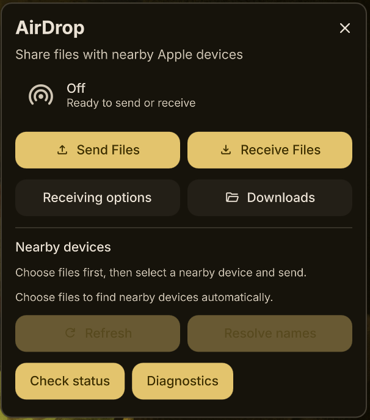

# DMS AirDrop

Native AirDrop sending and receiving controls for **DankMaterialShell**, powered by your existing **Omdrop** installation.

Send files to compatible Apple devices, receive files from them, and manage discovery from a DMS bar widget. The KDE file picker offers multi-selection and thumbnails for supported file types.

**Installing this plugin installs the interface. A separately configured, compatible AirDrop radio backend is required for transfers. It does not enable AirDrop on every Wi-Fi adapter.**

[Latest release](https://github.com/Kratospidey/dms-airdrop/releases/latest) · [v0.2.2 notes](docs/RELEASE_0.2.2.md) · [Marketplace setup](docs/MARKETPLACE.md) · [Friend setup guide](docs/FRIEND_SETUP.md) · [Compatibility](docs/COMPATIBILITY.md) · [Troubleshooting](docs/TROUBLESHOOTING.md)

## Features

- DMS bar widget, popout and settings, with one shared controller across monitors.
- Send one or more local files to nearby Apple devices; receive into your existing Omdrop folder.
- Basic file selection immediately after installation; optional KDE browsing, zoom and thumbnails selected automatically when available.
- Automatic discovery after file selection, timed receiving and Receive Once.
- Temporary sending sessions with ownership checks before cleanup.
- Asynchronous transfers that survive closing the popout or reloading the plugin.
- Brief success notifications and persistent, actionable errors.



Authentic screenshot of the installed plugin, cropped to its popout. The golden accent follows the user’s DMS theme; no UI text or controls were altered.

## Requirements

| Component | Requirement |
| --- | --- |
| Platform | Linux desktop with Wayland; Niri is the tested compositor |
| DMS | Installer baseline ≥1.6.2; only 1.6.2 tested |
| Quickshell | Installer baseline ≥0.3.1, Qt 6 Quick/Dialogs support; only 0.3.1 tested |
| Python | 3.10 or newer, standard library only |
| Operations | Working systemd user manager, `systemctl`, `systemd-run`, `ss` (iproute2) |
| AirDrop CLI | **Omdrop 0.14.1**, already configured; mutations reject other versions |
| Radio | Separately installed compatible backend; omdrop-owl 0.1.0 tested |
| Native picker | CMake ≥3.20, C++17 compiler, Make, Qt 6 Widgets development files, KF6 KIO and IconThemes ≥6.0 |
| Picker extras | Breeze style/icons; KIO thumbnail plugins such as kio-extras for more file types |

The CMake declarations describe build requirements, not a tested range of every Qt/KDE release. The native picker was built with Qt 6.11.2 and KDE Frameworks 6.30.0. Without an executable native helper, **Send Files** opens the basic Qt picker immediately. Auto mode detects a helper built later on the next selection. DMS's **File picker** setting saves Auto, KDE enhanced or Basic across restarts; both Auto and KDE recover to Basic if needed. Basic supports multi-selection but does not promise thumbnails.

## Install

AirDrop is accepted into the **official DMS plugin registry** through merged [PR #1029](https://github.com/AvengeMedia/dms-plugin-registry/pull/1029). Install through **DMS Settings → Plugins → Browse → AirDrop**, enable it and add its widget to your DankBar. See [marketplace setup](docs/MARKETPLACE.md) for prerequisites and optional KDE enhancement. If your catalog is cached, refresh it through DMS before searching.

### Manual GitHub installation

The manual installer is an alternative to DMS's marketplace installation. First install DMS using its [official instructions](https://danklinux.com/docs/dankmaterialshell/installation). Keep the clone in a permanent location:

```sh
git clone https://github.com/Kratospidey/dms-airdrop.git
cd dms-airdrop
./install.sh
./install.sh --apply
```

The first installer invocation checks dependencies and previews changes. `--apply` builds and verifies the KDE helper locally when build dependencies are available, then creates a per-user symlink:

```text
${XDG_CONFIG_HOME:-$HOME/.config}/DankMaterialShell/plugins/dmsAirDrop
```

Open **DMS Settings → Plugins → Scan for Plugins**, enable **AirDrop**, then add its widget to your DankBar layout. The installer never changes the layout or restarts DMS. After a source update, a plugin-only reload can retain stale QML subcomponents. If the old UI persists or loading reports a missing `fallbackComponent` property, finish transfers and restart DMS yourself when convenient; see [Troubleshooting](docs/TROUBLESHOOTING.md).

The clone is the installation: **moving or deleting it breaks the symlink**. Matching symlinks are idempotent; conflicting paths or duplicate IDs are refused. No packages are installed automatically, and no root access is required for the frontend.

Useful commands:

```sh
./install.sh check                      # read-only prerequisite report
./install.sh --picker native            # require native prerequisites, dry run
./install.sh --apply --picker native    # require a successful local native build
./install.sh --apply --picker basic     # skip the optional native build
python3 scripts/build-picker.py         # build/rebuild only the local helper
```

`--picker basic` skips building; it does not remove a helper already built. A detected-but-failed native build aborts installation before creating a new symlink. Correct the reported error or explicitly choose the basic option.

For Arch/CachyOS package names and release archive installation, see [Friend setup](docs/FRIEND_SETUP.md). Other distributions are untested.

### DMS marketplace installation

The [accepted registry entry](docs/REGISTRY_READINESS.md) makes AirDrop discoverable in DMS's marketplace. DMS clones the frontend directly and does not run this installer, install backend packages or compile the optional KDE helper. A fresh clone opens the basic picker on the first **Send Files** click. Registry acceptance does not establish radio compatibility or a working transfer setup. Follow [marketplace setup](docs/MARKETPLACE.md) for optional KDE enhancement and update/removal steps.

## First-time backend setup

Run `./install.sh check`. Missing Omdrop or radio prerequisites produce warnings and permit frontend installation; **they do not mean AirDrop works**. Without a usable backend the widget shows an unavailable/error state and cannot send or receive.

Follow [Omdrop's documentation](https://github.com/brentkearney/omdrop-plugin) and the hardware-specific backend documentation before using this frontend. These upstream setup procedures can require privileged driver, network and firewall changes; review them yourself. This installer does not run them. Preserve any setup that already works.

The adapter expects the upstream Omdrop source layout (the CLI resolves to `bin/omdrop` beside `share/airdrop-receiver.service`), an already-installed matching receiver service and existing identity files. It blocks operations that would trigger known implicit setup or service migration. A repackaged CLI with a different layout may fail preservation checks.

## Use

**Send:** Open the popout → **Send Files** → select local files → choose a nearby device → send. Choosing files while Off opens a temporary, discoverable receiving window. Existing manual receiving is reused. Open AirDrop on the recipient and use Everyone when its identity/visibility requirements call for it. Refresh names explicitly if a device is anonymous; name lookup may use Bluetooth wake-up.

**Receive:** Choose Receive Once or a timed window and send from your Apple device to the existing Omdrop device name. Received files go to the folder already configured in Omdrop.

**Stop:** Use Turn Off when transfers have finished. Ordinary stop never forces a running send to terminate. Closing the popout does not cancel a transfer.

**Cleanup:** A plugin-owned sending session is normally closed after completion or cancellation. Abandoned discovery expires after five minutes when no plugin operation is running. A 60-minute Omdrop window is the hard cap and can expire during a very long transfer. Cleanup preserves independently changed or unverifiable sessions; check the message and turn receiving off manually when needed. Automatic ownership detection currently relies on OWL metadata.

**Settings:** Change the display name or choose Everyone explicitly while receiving is Off. Advanced identity/contact and download-folder configuration remain in Omdrop; the plugin does not edit the receiver service to change folders.

## Hardware compatibility

The development laptop uses **CachyOS + Niri, Realtek RTL8852BE-VT, rtw89_8852bte, Omdrop 0.14.1 and omdrop-owl 0.1.0**. Incoming and outgoing transfers worked on this configuration before the final marketplace corrections. That is one experimental hardware result, not general Realtek support. v0.2.2 uses automated regression validation; no new physical-device transfer tests were performed for this maintenance release.

Upstream OWL currently lists MediaTek MT7925 as tested. Other drivers require deliberate experimental opt-in and may affect Wi-Fi connectivity. This installer never creates `/etc/omdrop/allow-untested`. [OWL hardware guidance](https://github.com/t4t5/omdrop-owl#supported-hardware)

The Broadcom backend targets specific Apple Wi-Fi firmware, not all Broadcom cards. It has not been tested with this DMS frontend; OWL-specific automatic cleanup cannot be assumed there. [Broadcom hardware table](https://github.com/brentkearney/omdrop-awdl#hardware-compatibility)

See [the compatibility matrix](docs/COMPATIBILITY.md) before choosing a backend.

## Update and uninstall

For a **marketplace installation**, finish transfers and temporary sessions, then use DMS's plugin update controls. The manager obtains source from the repository's default branch; it does not install a release archive or build the native helper. Do not run the manual symlink installer inside a registry-managed directory.

For a **manual symlink installation**, finish transfers, close temporary sending sessions and disable AirDrop in DMS before updating source used by its symlink. Preserve local edits before changing versions:

```sh
git status --short
git pull --ff-only
./install.sh
./install.sh --apply
```

Re-enable the plugin afterwards. A tagged release can be selected with `git switch --detach v0.2.2` in a clean checkout; keep track of the previous tag/commit for rollback. Switching tags changes the installed source too. Never overwrite local edits to force an update. For either installation method, a complete DMS restart after finishing operations can resolve stale QML components that survive a plugin-only reload.

For marketplace removal, use DMS's own Remove action. To uninstall a manual symlink, first finish operations and disable the plugin in DMS:

```sh
./install.sh uninstall
./install.sh uninstall --apply --disabled
```

Only this clone's symlink is removed. The clone, compiled helper, preferences, received files, Omdrop, identities, radio backend and other plugins remain. Optional restoration of **only name/visibility changes made by this plugin** is separate:

```sh
./install.sh restore-settings
./install.sh restore-settings --apply --disabled
```

Restoration requires AirDrop Off and refuses independently changed settings. Local development rollback scripts need private baseline manifests and are not an update/uninstall procedure for public users.

## Security, development and license

The plugin runs with your desktop user's permissions. Selecting files can start discovery and receiving; nearby devices may see you during that window. Runtime requests are private but contain selected paths briefly. Transfer confidentiality, recipient authentication and protocol behavior depend on Omdrop and the installed backend. See [Security](SECURITY.md) and [Architecture](docs/ARCHITECTURE.md).

[Testing](docs/TESTING.md) documents mocked versus real checks. [Contributing](CONTRIBUTING.md) explains reporting and source changes. [Registry status](docs/REGISTRY_READINESS.md) records the accepted entry and review history; acceptance does not certify hardware compatibility.

MIT licensed integration code. Thanks to the DMS, Quickshell, Omdrop, OWL, Qt and KDE contributors; see [third-party attribution](THIRD_PARTY.md). These dependencies are installed separately and retain their own licenses. Development used AI assistance. AirDrop is a trademark of Apple Inc. This independent integration is not affiliated with or endorsed by Apple, KDE or the DMS maintainers.
